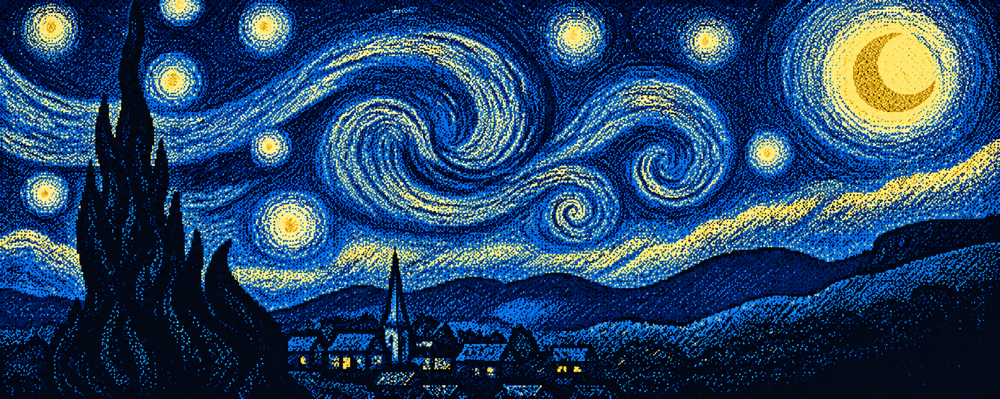
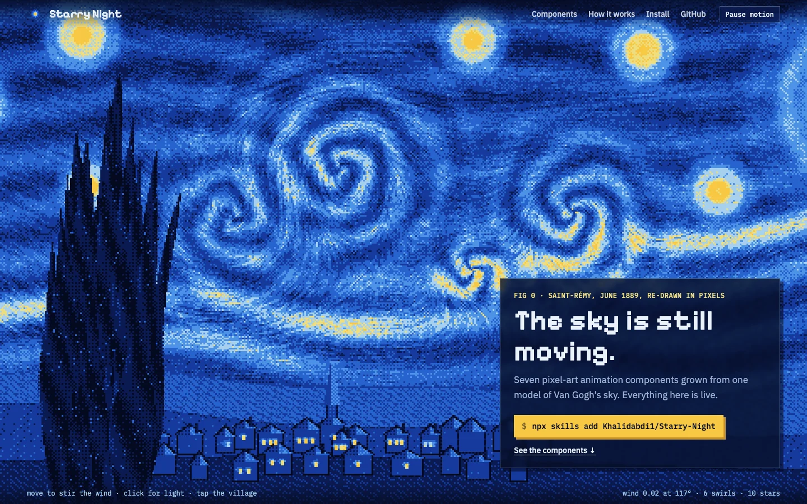
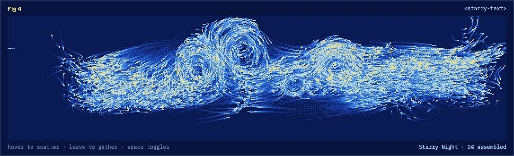
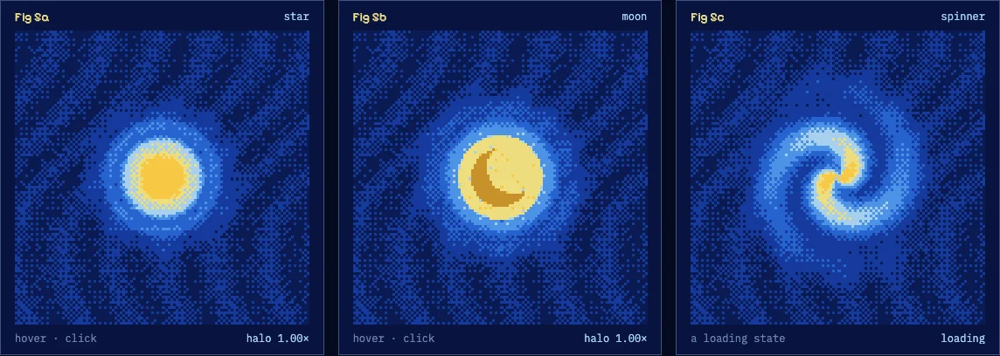

<p align="center">
  
</p>

<h1 align="center">Starry Night</h1>

<p align="center"><b>Pixel-art animation components drawn from Van Gogh's <i>The Starry Night</i>, packaged as an agent skill.</b><br>
Seven zero-dependency web components that grow out of one small model of the painting's swirling wind.</p>

<p align="center">
  <a href="https://khalidabdi1.github.io/Starry-Night/"></a>
  &nbsp;
  <a href="#install"></a>
</p>

<p align="center">
  <a href="https://skills.sh"></a>
  <a href="https://agentskills.io"></a>
  
  <a href="LICENSE"></a>
  <a href="https://github.com/Khalidabdi1/Starry-Night/actions/workflows/ci.yml"></a>
</p>

---

The image above is a still. This project makes it move. The sky flows around its swirls, stars breathe in ringed halos, the cypress sways like a real trunk, and the village lamps come on one after another. Everything is pixel art by construction: it is drawn on a coarse grid and snapped to one 8-tone palette sampled from the painting.

The trick is that **the painting is the model**. `model.mjs` places six vortices exactly where the painting's swirls are, plus ten stars, the moon, and the river of cloud that rises toward it. A WebGL shader smears brush strokes along that wind, particles ride it, and letters scatter into it. Because every component reads the same wind, they compose: layer a sky, a village and a cypress and they agree on where the wind goes.

It ships as a **skill** for [skills.sh](https://skills.sh). Install it and your coding agent learns the palette, the model and the motion rules, and can build new Starry Night animations with the kit.

## Gallery

<p align="center"></p>
<p align="center"><sub>The demo hero is three components layered into the painting: <code>starry-sky</code>, <code>starry-village</code> and <code>starry-cypress</code>, all riding one wind.</sub></p>

<table>
  <tr>
    <td width="50%"></td>
    <td width="50%"></td>
  </tr>
  <tr>
    <td><sub><b>starry-text</b>, hovered: every particle leaves its letter and rides the painting's wind, then pours back when the pointer leaves.</sub></td>
    <td><sub><b>starry-star</b>: a star, the moon and the spinner (the painting's tight curl).</sub></td>
  </tr>
</table>

## Components

| | Component | What it does |
|---|---|---|
| 🌌 | `<starry-sky>` | The living sky (WebGL2). Brush strokes from line-integral convolution along the wind, spiral bands around each vortex, ringed stars, the crescent moon. The pointer stirs a vortex, a click sends a ripple of light. |
| 🖼️ | `<starry-painting src>` | Makes any still image flow. A two-phase flow map advects the sky along the wind and loops with no reset. Stars shimmer, and the land and cypress are held still. |
| 🖌️ | `<starry-swirl>` | Thousands of brush-stroke particles riding the wind, each fading in and out. Strokes born near a star or a swirl paint gold. |
| ✍️ | `<starry-text>` | Words written in wind. Each glyph pixel is a particle's home; hover blows the word into the swirls, and it pours back. |
| ⭐ | `<starry-star>` | A star, the moon or a spinner. It swells on hover (critically damped) and flares on click (attack/decay envelope). |
| 🌲 | `<starry-cypress>` | The dark flame. A broad body with tongues licking off it, bending on an underdamped spring pushed by gusts and the pointer. |
| 🏘️ | `<starry-village>` | Hills, houses and the church spire. The windows light in a cascade 45 ms apart, rippling out from your click. Chimney smoke leans with the wind. |

Every component:
- stops when offscreen, and goes to one still frame under `prefers-reduced-motion` (it still answers input)
- runs an idle tour that yields to the reader
- is keyboard-accessible, with a role and label
- publishes a live readout through `aria-valuetext` and a `readout` event, such as `wind 0.21 at 12° · 6 swirls · 10 stars` or `17 of 24 windows lit`

The two shader components fall back to 2D or a plain image without WebGL2.

## Install

### As an agent skill (skills.sh)

```sh
npx skills add Khalidabdi1/Starry-Night
```

The CLI asks which agents to set up (Claude Code, Codex, Cursor, OpenCode and more). Then ask your agent something like:

```text
make a Starry Night hero for my landing page with the title "Night Notes"
add a Starry Night loading spinner to my React app
bring my illustration city.png to life like the Starry Night demo
```

The skill lives in [`skills/starry-night/`](skills/starry-night/): [`SKILL.md`](skills/starry-night/SKILL.md), the kit, six references, a headless-Chrome capture script and evals.

### As web components

Copy [`skills/starry-night/kit/`](skills/starry-night/kit/) into your site. There is no build step and nothing to install.

```html
<script type="module" src="kit/index.mjs"></script>

<starry-sky style="height: 70vh"></starry-sky>
<starry-text text="Good night"></starry-text>
<starry-star variant="spinner" style="width: 48px"></starry-star>
<starry-painting src="my-painting.webp" flow="1.2"></starry-painting>
```

### In React or Next.js

```tsx
import { useState } from "react";
import { StarrySky, StarryStar } from "./kit/react/starry-night";

export default function Hero() {
  const [readout, setReadout] = useState("");
  return (
    <>
      <StarrySky speed={1.2} focus={0.47} onReadout={setReadout} style={{ height: 520 }} />
      <StarryStar variant="spinner" style={{ width: 48 }} />
    </>
  );
}
```

The wrappers render the bare tag on the server and load the element on the client, so they are safe in the App Router.

## Composing a scene

The demo's hero is three components layered back to front, all at the same `pixel` value:

```html
<div class="scene">
  <starry-sky pixel="3"></starry-sky>
  <starry-village transparent pixel="3"></starry-village>
  <starry-cypress transparent pixel="3"></starry-cypress>
</div>
```

See [`references/components.md`](skills/starry-night/references/components.md#composing-a-scene) for the CSS and the pointer forwarding.

## How it works

- **One model.** Each vortex is a Lamb–Oseen core with a Gaussian reach: it turns like a solid disc at the centre, falls off as 1/r, and fades out so it stays local. The same field exists once in JavaScript and once in GLSL, and `tools/check.mjs` fails the build if their constants drift apart. Details: [`references/model.md`](skills/starry-night/references/model.md).
- **Pixel art by construction.** Each component draws at `box / pixel` resolution and CSS scales it up with crisp pixels. Every colour snaps to one ramp (ink, night, ultramarine, cobalt, azure, frost, straw, gold) with 4×4 ordered dither, so the shader and the 2D components can't drift apart in look. Details: [`references/craft.md`](skills/starry-night/references/craft.md).
- **Calm, true motion.** Time-based steps with dt capped at 1/30 s. Exponential follow for pointers, real springs for springy things, critically damped settles for values that must arrive cleanly, and attack/decay envelopes for events, so nothing pops. Details: [`references/motion.md`](skills/starry-night/references/motion.md).
- **Verified by looking.** `scripts/capture.mjs` drives headless Chrome over the DevTools protocol with zero dependencies. It takes screenshots at any size, moves the pointer, presses keys, records motion strips, emulates reduced motion and runs without WebGL. It exits 1 on any page error.

## Repository layout

```
index.html, demo/              the demo website (GitHub Pages)
assets/starry-night-pixel.png  the pixel-art panorama
skills/starry-night/           the skill: what `npx skills add` installs
  SKILL.md
  kit/                         core, model, raster, gl, 7 components, index.mjs, react/
  references/                  components, model, craft, motion, new-component, verify
  scripts/capture.mjs          headless Chrome capture
  assets/starry-night.webp     the panorama for <starry-painting>
  evals/evals.json, agents/openai.yaml
tools/check.mjs                repo checks (run in CI)
```

## Run the demo locally

```sh
git clone https://github.com/Khalidabdi1/Starry-Night.git
cd Starry-Night
python3 -m http.server 8000     # or any static server
# open http://localhost:8000
node tools/check.mjs            # skill + model checks
```

## Credits

- After Vincent van Gogh, *The Starry Night*, 1889, Museum of Modern Art, New York.
- The motion and verification discipline is adapted from [Anatomy](https://github.com/wheresryan22/anatomy) by wheresryan22: one pure model driving every number, framed figure cards with a live readout, envelopes that never pop, idle tours, and checking every screenshot.
- MIT licensed. See [LICENSE](LICENSE).
